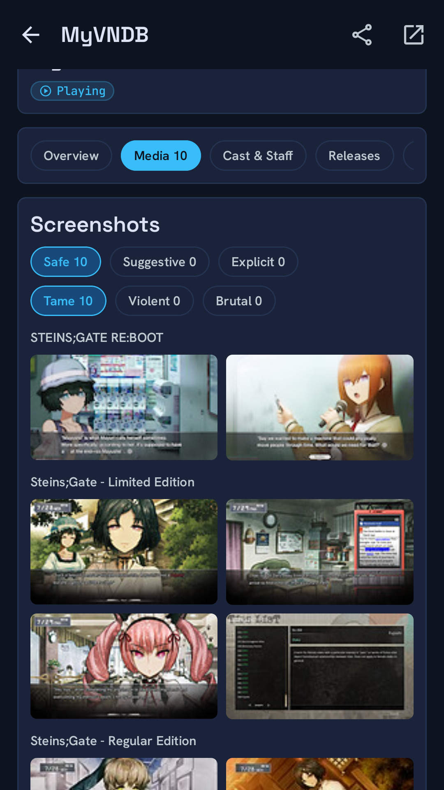

# MyVNDB

An unofficial Android client for [vndb.org](https://vndb.org), the Visual Novel Database. It uses the
public [VNDB API (Kana)](https://api.vndb.org/kana).

Browse and search visual novels, then dig into the details: tags, releases, screenshots, staff, characters and voice
actors.

<table>
  <tr>
    <td></td>
    <td></td>
    <td></td>
    <td></td>
  </tr>
  <tr>
    <td></td>
    <td></td>
    <td></td>
    <td></td>
  </tr>
</table>

## Technologies

- Kotlin
- Jetpack Compose (Material 3, Adaptive)
- Navigation 3
- Koin (Annotations, via the Koin compiler plugin)
- Ktor
- kotlinx.serialization
- Coroutines and Flow
- Coil
- Detekt

## Architecture

- Single `:app` module, organised by feature (discover, browse, detail, character, release, profile, login)
- Clean Architecture: each feature has `data`, `domain`, `presentation` and `di` packages
- MVI in the presentation layer: a ViewModel exposes one state and one-off effects, and handles intents
- Shared code lives in `common`

## Requirements

- Android Studio (latest stable)
- JDK 11+
- Android 8.1 (API 27) or newer

## Build

Two flavors, each with debug and release builds:

| Flavor        | Application id                      | App name   | Release signing                                                        |
|---------------|-------------------------------------|------------|------------------------------------------------------------------------|
| `development` | `com.zc.vndb.dev` (version `…-dev`) | MyVNDB Dev | `debug.keystore` in the repo                                           |
| `production`  | `com.zc.vndb`                       | MyVNDB     | Play upload key, passed in when building (see [Releasing](#releasing)) |

Both flavors can be installed side by side.

```bash
./gradlew installDevelopmentDebug
```

```bash
./gradlew assembleDevelopmentRelease
```

```bash
./gradlew testDevelopmentDebugUnitTest
```

## Releasing

Pushing a tag `v<versionName>-<versionCode>-<track>` publishes to that Google Play track,
through [fastlane](https://docs.fastlane.tools/actions/supply/) pinned in `Gemfile.lock`.

| Track        | Google Play            | Workflow                          | What the tag does                                                                                                                |
|--------------|------------------------|-----------------------------------|----------------------------------------------------------------------------------------------------------------------------------|
| `internal`   | Internal testing       | Play release (`play-release.yml`) | Builds the `productionRelease` bundle with that version, signs it with the Play upload key and uploads it                        |
| `alpha`      | Closed testing – Alpha | Play release                      | Same                                                                                                                             |
| `beta`       | Open testing           | Play release                      | Same                                                                                                                             |
| `production` | Production             | Play promote (`play-promote.yml`) | Promotes the build Alpha has with that version code. Nothing is cloned or built: it checks out only `Gemfile` and `Gemfile.lock` |

Test on Alpha, then promote the same build:

```bash
git tag -a v1.0.1-3-alpha -m "What's new in this release (at most 500 characters)."
```

```bash
git push origin v1.0.1-3-alpha
```

```bash
git tag v1.0.1-3-production
```

```bash
git push origin v1.0.1-3-production
```

- An `-alpha`, `-beta` or `-internal` tag's message becomes the release notes. A production release keeps the notes it
  had on Alpha.
- Each version code can be uploaded to Play only once, so every new build needs a higher code.
- A production tag fails, changing nothing, if Alpha doesn't have that version code.

Setup, secrets and troubleshooting: [docs/plans/18-play-release-pipeline.md](docs/plans/18-play-release-pipeline.md).

## Disclaimer

Not affiliated with vndb.org. All data is provided by VNDB and subject to its terms.

## License

Licensed under the [Apache License, Version 2.0](LICENSE).
